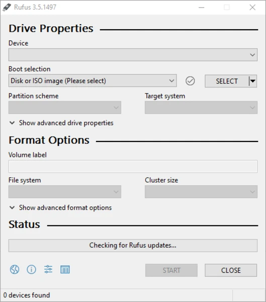

# From Windows to Ubuntu: A Complete Dual-Boot Installation Guide

## Introduction

For many developers, Linux provides a more powerful and reliable development environment than Windows. Although Windows Subsystem for Linux (WSL) brings many Linux capabilities to Windows, it can still suffer from compatibility issues and limitations. Virtual machines are another option but often consume significant system resources and may not deliver native performance.

For developers seeking maximum performance, stability, and complete access to Linux, dual booting Ubuntu alongside Windows remains one of the best options. Ubuntu offers an excellent balance of usability, stability, security, and a vast software ecosystem.

This guide walks through the complete process of installing Ubuntu alongside Windows, covering disk partitioning, boot configuration, common installation problems, and their solutions.

---

# What You Will Learn

- Prepare your system for dual boot
- Create a bootable Ubuntu USB
- Partition your storage correctly
- Install Ubuntu alongside Windows
- Understand UEFI and Legacy BIOS
- Resolve common installation and boot problems

---

# Requirements
To dual-boot Ubuntu with Windows You need the following : 
- USB flash drive (8 GB or larger)
- Ubuntu ISO downloaded from the official website
- Rufus
- At least 30–50 GB of unallocated disk space
- Backup of important files

---

# Why Dual Boot Ubuntu?

Dual booting allows Windows and Ubuntu to coexist on the same computer. Every time your computer starts, you can choose which operating system to boot.

Benefits include:

- Native Linux performance
- Full hardware compatibility
- Better development environment
- Access to Windows whenever needed
- No virtualization overhead

---

# Step 1 – Determine Your Boot Mode

In Windows:

1. Press `Win + R`
2. Type:

```text
msinfo32
```

3. Press Enter.
4. Check **BIOS Mode**.

- **UEFI** → GPT partition style
- **Legacy** → MBR partition style

Windows and Ubuntu should use the same partition scheme.

---

# Step 2 – Create a Bootable Ubuntu USB

Using Rufus:

- Select the Ubuntu ISO.
- Choose GPT for UEFI or MBR for Legacy BIOS.
- Select FAT32.
- Click **Start**.

---

# Step 3 – Create Free Disk Space

1. Open Disk Management.
2. Right-click the Windows partition.
3. Choose **Shrink Volume**.
4. Shrink by at least 30 GB.

Leave the new space as **Unallocated**.

---

# Step 4 – Boot from the USB Drive

Restart the computer and open the Boot Menu (F12, F10, F9, or Esc depending on your system).

Select the USB drive and choose **Install Ubuntu**.

---

# Step 5 – Installation Type

Choose one of the following:

## Option 1 – Install Ubuntu Alongside Windows

Recommended for beginners.

## Option 2 – Something Else

Create the following partitions manually.

| Partition | Size | File System | Mount Point |
|-----------|------|-------------|-------------|
| Root | 25 GB or larger | ext4 | `/` |
| Swap | 4 GB | swap | — |
| EFI (UEFI only) | 512 MB | FAT32 | `/boot/efi` |

---

# Step 6 – Complete the Installation

After installation:

- Remove the USB drive.
- Restart the computer.
- Select Ubuntu or Windows from the GRUB boot menu.

---

# Updating Ubuntu

```bash
sudo apt update
sudo apt upgrade -y
```

---

# Common Problems

## GPT and MBR Mismatch

### Problem

Windows and the Ubuntu installer use different partition schemes.

### Solution

Ensure both use GPT or both use MBR.

Check in:

**Disk Management → Disk Properties → Volumes**

---

## Ubuntu Does Not Boot

Enter BIOS/UEFI and move Ubuntu to the top of the boot order.

If necessary, disable Windows Fast Startup:

**Control Panel → Power Options → Choose what the power buttons do → Disable Fast Startup**

---

## Latest Ubuntu Version Fails to Install

Possible causes:

- GPU drivers
- Secure Boot
- BIOS incompatibility

Install a stable LTS release such as Ubuntu 22.04 LTS, then upgrade later.

```bash
sudo do-release-upgrade
```

or

```bash
sudo apt update
sudo apt full-upgrade -y
```

---

## Repairing GRUB

Boot from the Ubuntu USB and choose **Try Ubuntu**.

Run:

```bash
sudo add-apt-repository ppa:yannubuntu/boot-repair
sudo apt update
sudo apt install boot-repair
boot-repair
```

---

# Best Practices

- Back up important data.
- Use the same partition style for both operating systems.
- Allocate sufficient disk space.
- Update Ubuntu after installation.
- Keep a bootable Ubuntu USB for recovery.

---

# Conclusion

Dual booting Ubuntu with Windows provides the flexibility of Windows alongside the power of Linux. It is an excellent setup for developers, students, and enthusiasts who want native Linux performance without giving up access to Windows applications.

By following this guide, you should be able to install Ubuntu safely, configure a reliable dual-boot environment, and troubleshoot the most common installation issues.
